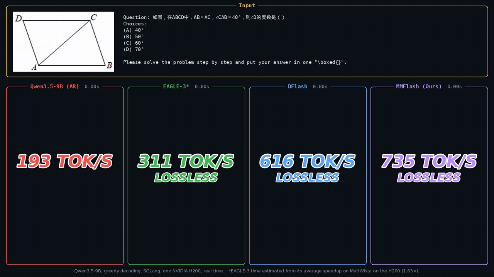

<div align="center">
      <h2><b> MMFlash: Faster Speculative Decoding for Vision-Language Models </b></h2>
</div>

<div align="center">


<a href="#-citation" target="_blank"></a>
<a href="https://huggingface.co/collections/FSCCS/mmflash-6af09b489ba5237bda91177f" target="_blank"></a>

</div>

> **MMFlash: Faster Speculative Decoding for Vision-Language Models** \
> [Sicheng Feng](https://fscdc.github.io/), [Zigeng Chen](https://czg1225.github.io/chenzigeng99/), Song Wang, [Gongfan Fang](https://fangggf.github.io/), [Xinchao Wang](https://sites.google.com/site/sitexinchaowang/) \
> National University of Singapore

---

<p align="center">
  
</p>
<p align="center"><sub>Qwen3.5-4B on a MathVerse question, recorded in real time on one NVIDIA H200 with SGLang (greedy decoding).
Speculative decoding is lossless: here every method prints the same answer as the target alone. Full-quality video: <a href="assets/demo.mp4">assets/demo.mp4</a>.</sub></p>

## ⭐ Updates

- **[11.2026]**: Code and MMFlash drafts for Qwen3.5-4B, Qwen3.5-9B, Qwen3.8-27B and Gemma 4 E4B-it are released.

---

## 💪 Highlights

- **Diffusion drafting for VLMs**: MMFlash brings block-diffusion drafting to vision-language models. The drafter proposes a block of 16 tokens in a single forward pass and the target verifies the block in one pass, so decoding stays lossless while running **3.0×** faster on Qwen3.5-4B / 9B and up to **4.7×** on Qwen3.8-27B (one H200, batch size 1, greedy).
- **Vision-free drafter**: the drafter never re-encodes the image or video. It reads hidden states of the target, where the visual context is already fused, so its cost does not grow with the number of visual tokens.
- **Visual-dependence-aware training**: a DFlash drafter's acceptance drops sharply on tokens that depend on the image, and most rejected blocks break there. MMFlash measures each training token's visual dependence on the target and focuses the drafter's loss on those tokens.
- **Long videos**: a sparse draft context (attention sinks, text, strided visual tokens and a recent window) keeps drafting cheap on 40k-token video prompts; the drafter is trained and served with the same pattern.
- **Drop-in serving**: the released drafts run with stock SGLang and vLLM (`DFLASH`), no patches needed (tested with SGLang 0.5.23 and vLLM 0.33.0).

---

## 📚 Table of Contents

- [💻 Models](#-models)
- [🚀 Quick Start](#-quick-start)
- [🔧 Installation](#-installation)
- [🔥 Training](#-training)
- [⚡ Evaluation](#-evaluation)
- [☀️ Acknowledgement](#-acknowledgement)
- [📖 Citation](#-citation)

---

## 💻 Models

| Model | Target model | Draft size | Block size | Link |
|-------|--------------|-----------:|-----------:|------|
| 🤖 Qwen3.5-4B-MMFlash | [Qwen/Qwen3.5-4B](https://huggingface.co/Qwen/Qwen3.5-4B) | 537M | 16 | [Hugging Face](https://huggingface.co/FSCCS/Qwen3.5-4B-MMFlash) |
| 🤖 Qwen3.5-9B-MMFlash | [Qwen/Qwen3.5-9B](https://huggingface.co/Qwen/Qwen3.5-9B) | 1.05B | 16 | [Hugging Face](https://huggingface.co/FSCCS/Qwen3.5-9B-MMFlash) |
| 🤖 Qwen3.8-27B-MMFlash | [Qwen/Qwen3.8-27B](https://huggingface.co/Qwen/Qwen3.8-27B) | 1.73B | 16 | [Hugging Face](https://huggingface.co/FSCCS/Qwen3.8-27B-MMFlash) |
| 🤖 Gemma4-E4B-it-MMFlash | [google/gemma-4-E4B-it](https://huggingface.co/google/gemma-4-E4B-it) | 537M | 16 | [Hugging Face](https://huggingface.co/FSCCS/Gemma4-E4B-it-MMFlash) |

The drafts are not standalone language models: each is paired with its target in a speculative-decoding server. All of them are in the [MMFlash collection](https://huggingface.co/collections/FSCCS/mmflash-6af09b489ba5237bda91177f); every model card has the serving command and per-benchmark results.

---

## 🚀 Quick Start

Serving needs only a recent SGLang or vLLM, not this repository.

**SGLang** (tested with 0.5.23):

```bash
pip install sglang==0.5.23

SGLANG_ENABLE_OVERLAP_PLAN_STREAM=1 python -m sglang.launch_server \
  --model-path Qwen/Qwen3.5-4B \
  --speculative-algorithm DFLASH \
  --speculative-draft-model-path FSCCS/Qwen3.5-4B-MMFlash \
  --speculative-dflash-block-size 16 \
  --attention-backend fa3 \
  --mm-attention-backend sdpa \
  --disable-radix-cache \
  --reasoning-parser qwen3 \
  --trust-remote-code \
  --port 30000
```

**vLLM** (tested with 0.33.0):

```bash
pip install vllm==0.33.0

vllm serve Qwen/Qwen3.5-4B \
  --dtype bfloat16 \
  --max-model-len 32768 \
  --attention-backend FLASH_ATTN \
  --reasoning-parser qwen3 \
  --speculative-config '{"method": "dflash", "model": "FSCCS/Qwen3.5-4B-MMFlash", "num_speculative_tokens": 15}' \
  --port 30000
```

Then send requests to the OpenAI-compatible endpoint as usual:

```python
import base64
from openai import OpenAI

client = OpenAI(base_url="http://127.0.0.1:30000/v1", api_key="EMPTY")
image = base64.b64encode(open("figure.png", "rb").read()).decode()
response = client.chat.completions.create(
    model="Qwen/Qwen3.5-4B",
    messages=[{
        "role": "user",
        "content": [
            {"type": "image_url", "image_url": {"url": f"data:image/png;base64,{image}"}},
            {"type": "text", "text": "Describe the figure, then answer the question in it step by step."},
        ],
    }],
    temperature=0.0,
    max_tokens=2048,
    extra_body={"chat_template_kwargs": {"enable_thinking": False}},
)
print(response.choices[0].message.content)
```

Model-specific notes:

- **Qwen3.5-9B**: replace the two model names above.
- **Qwen3.8-27B** on SGLang: add `--max-running-requests 16`. With `--disable-radix-cache`, SGLang reserves about 2.3 GB of verification state per allowed request at startup, and the default does not fit on one 141 GB H200. On 80 GB GPUs use `--tp 2`.
- **Gemma 4 E4B-it** on SGLang: set `SGLANG_GEMMA_OUT_OF_PLACE_POSITION_MUTATION=1`, use `--attention-backend triton --reasoning-parser gemma4` and drop `--disable-radix-cache`. On vLLM use `--reasoning-parser gemma4` without `--attention-backend`.

---

## 🔧 Installation

Training and the benchmark harness need the environment below. Training captures the target's hidden states from a patched SGLang 0.5.14 server and moves them to the trainer processes through [Mooncake](https://github.com/kvcache-ai/Mooncake).

```bash
git clone https://github.com/fscdc/MMFlash.git
cd MMFlash

conda create -n mmflash python=3.11 -y
conda activate mmflash
pip install -e .                              # torch 2.11, transformers 5.8.1, sglang 0.5.14, ...
pip install mooncake-transfer-engine==0.3.12.post1

# SGLang patches, applied to the installed sglang 0.5.14 (idempotent)
bash scripts/apply_sglang_spec_capture_patch.sh   # training: hidden-state capture from the serving engine
bash scripts/apply_sglang_gemma4_patch.sh         # training Gemma 4 drafts
bash scripts/apply_sglang_bench_patches.sh        # benchmarks: per-request decode timing, sparse video context
```

---

## 🔥 Training

A full run has four steps. The configs in [`configs/train/`](configs/train) reproduce the released drafts; each holds every setting of its run (data, objective, optimizer, and which GPUs host the capture server and the trainer). The commands below use Qwen3.5-4B.

### 1. Prepare and regenerate the training data

The drafter learns to imitate its target, so the responses of the training set are regenerated by the target itself. Start from a conversation JSONL with image paths (`scripts/prepare_data_mm.py` converts several public multimodal instruction datasets into this format), then:

```bash
MODEL=Qwen/Qwen3.5-4B INPUT=data/train.jsonl OUTPUT=data/regen/qwen3.5-4b.jsonl GPUS="0 1 2 3" \
    bash scripts/regenerate.sh
```

This runs one SGLang server per GPU (greedy, thinking off, at most 4096 new tokens) and retries failed rows until none is left. By default it first rewrites math and short-answer prompts into the step-by-step `\boxed{}` instruction that the benchmarks use, as for the released drafts (`ALIGN_PROMPTS=0` keeps the original prompts).

### 2. Score the visual dependence of every token (MMFlash only)

```bash
GPUS=0,1,2,3 bash scripts/score_visual_kl.sh configs/train/qwen3.5-4b-mmflash.yaml
```

The target runs each training row twice, with and without the image, and the per-token KL divergence and the with-image entropy go to the sidecar named by `data.visual_score_path`. Shards resume if interrupted, and a completeness check against the training set runs at the end.

### 3. Train

Point `data.train_data_path` and `data.visual_score_path` of the config at the files from steps 1 and 2, then:

```bash
bash scripts/train.sh configs/train/qwen3.5-4b-mmflash.yaml
# quick smoke run: bash scripts/train.sh configs/train/qwen3.5-4b-mmflash.yaml training.max_steps=100
```

`specforge train` (installed with this repo, also available as `mmflash`) starts and supervises everything: an SGLang server with the frozen target on GPU 0 that streams the hidden states of five target layers, the Mooncake store, and the trainers on GPUs 1-3. Change `deployment.disaggregated.managed_local` to use other GPUs. Main settings, following DFlash: block size 16, 512 anchors per sequence, batch size 2 with 4 accumulation steps, learning rate 6e-4 with cosine decay and 4% warmup, 6 epochs. The `*-dflash.yaml` configs train the DFlash baseline on the same data.

**Optional, long videos.** `configs/train/qwen3.5-{4b,9b}-mmflash-video-sparse.yaml` continue an exported draft (step 4) for 3 epochs on video rows with the sparse draft context.

### 4. Export

```bash
bash scripts/export_draft.sh outputs/qwen3.5-4b-mmflash/<checkpoint> configs/qwen3.5-4b-mmflash.json outputs/qwen3.5-4b-mmflash/export
```

The export directory is a `DFlashDraftModel` checkpoint that SGLang and vLLM load directly (`--speculative-draft-model-path`, or `"model"` in vLLM's `--speculative-config`).

---

## ⚡ Evaluation

The paper's image setting: ChartQA, CharXiv (reasoning), MMStar, MMBench, DynaMath, MathVista and MathVerse, 200 questions each, one request in flight, greedy decoding, at most 4096 new tokens, reasoning off.

```bash
# the target alone, then with the draft, on the same GPU
METHOD=origin  MODEL=Qwen/Qwen3.5-4B bash scripts/eval_image.sh
METHOD=mmflash MODEL=Qwen/Qwen3.5-4B DRAFT=FSCCS/Qwen3.5-4B-MMFlash bash scripts/eval_image.sh
```

Results go to `results/<name>_results.jsonl`: per benchmark the acceptance length τ, the decode throughput, the accuracy and per-question details. The speedup is the draft run's decode throughput divided by the origin run's. `TEMPERATURE=1` samples with top-p 0.95 and top-k 20.

- **Video** (LongVideoBench, MVBench, Video-MME at 48 frames): `scripts/eval_video.sh`; add `DRAFT_SPARSE="sink=4,text=1,stride=32,window=256"` for a draft trained with the sparse context.
- **Concurrency on vLLM** (1 to 32 requests in flight): `scripts/eval_vllm_concurrency.sh` (see its header for the setup).

---

## ☀️ Acknowledgement

The training code builds on [SpecForge](https://github.com/sgl-project/SpecForge), and the drafter follows [DFlash](https://github.com/z-lab/dflash). Serving relies on the DFlash support in [SGLang](https://github.com/sgl-project/sglang) and [vLLM](https://github.com/vllm-project/vllm), and the distributed data plane on [Mooncake](https://github.com/kvcache-ai/Mooncake). We thank the authors of these projects for making them openly available.

---

## 📖 Citation

If MMFlash is useful for your work, please give us a star ⭐ or cite us (the paper is coming soon):

```bibtex
@article{feng2026mmflash,
  title   = {MMFlash: Faster Speculative Decoding for Vision-Language Models},
  author  = {Feng, Sicheng and Chen, Zigeng and Wang, Song and Fang, Gongfan and Wang, Xinchao},
  journal = {arXiv preprint},
  year    = {2026}
}
```
